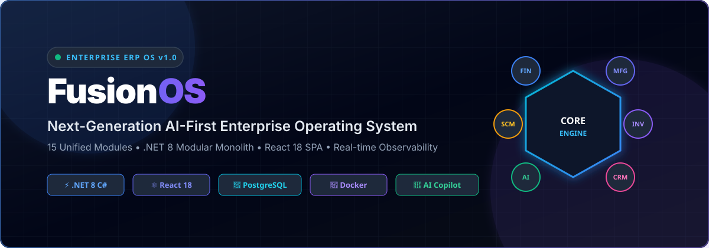
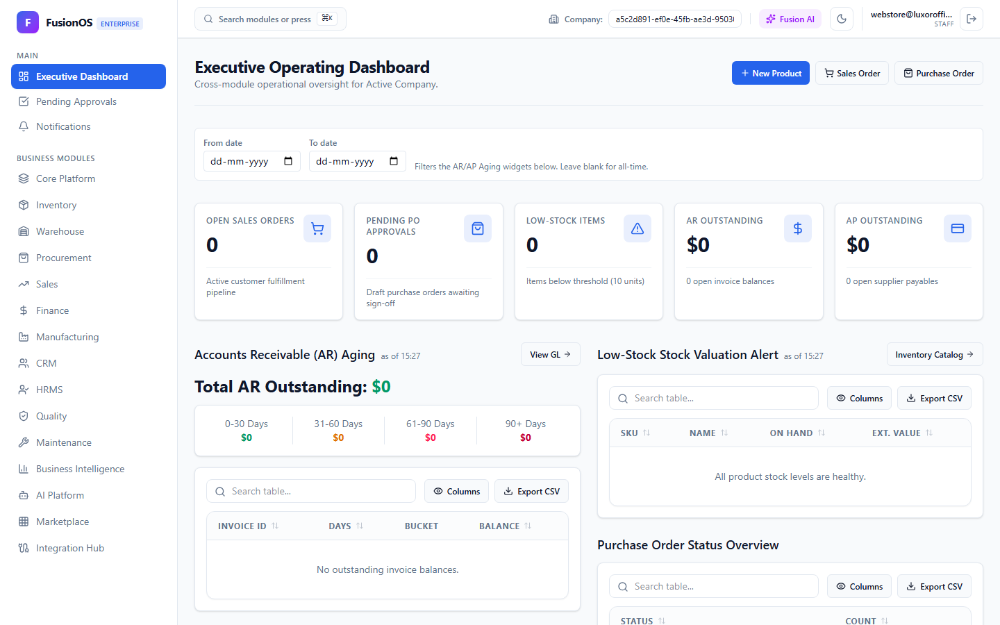
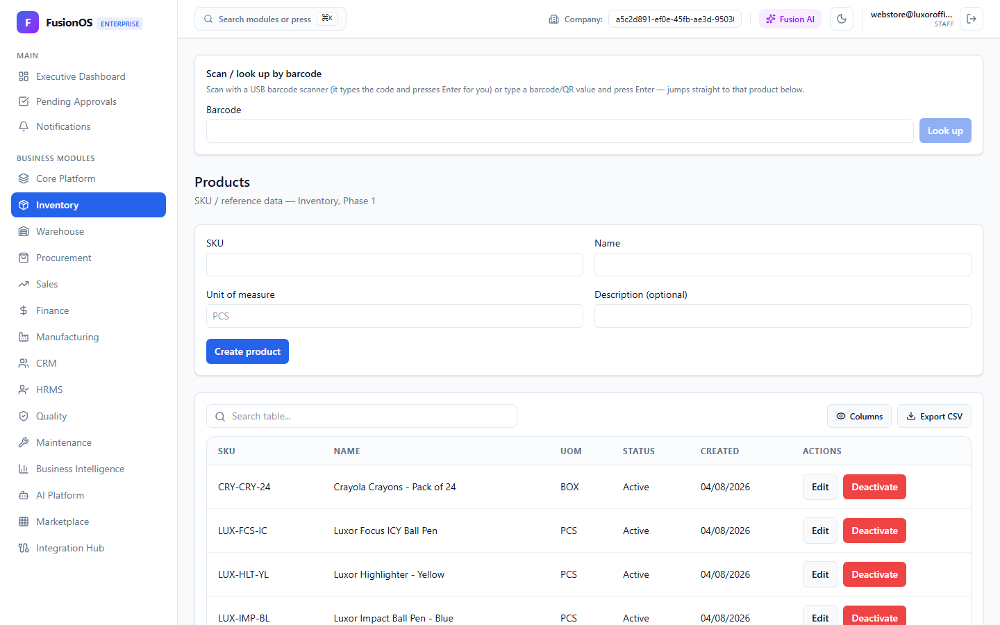
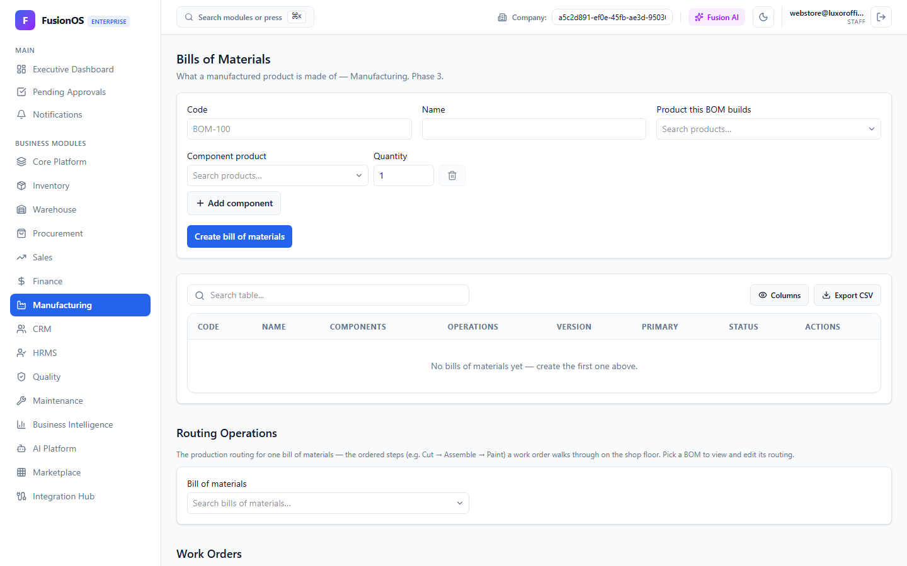
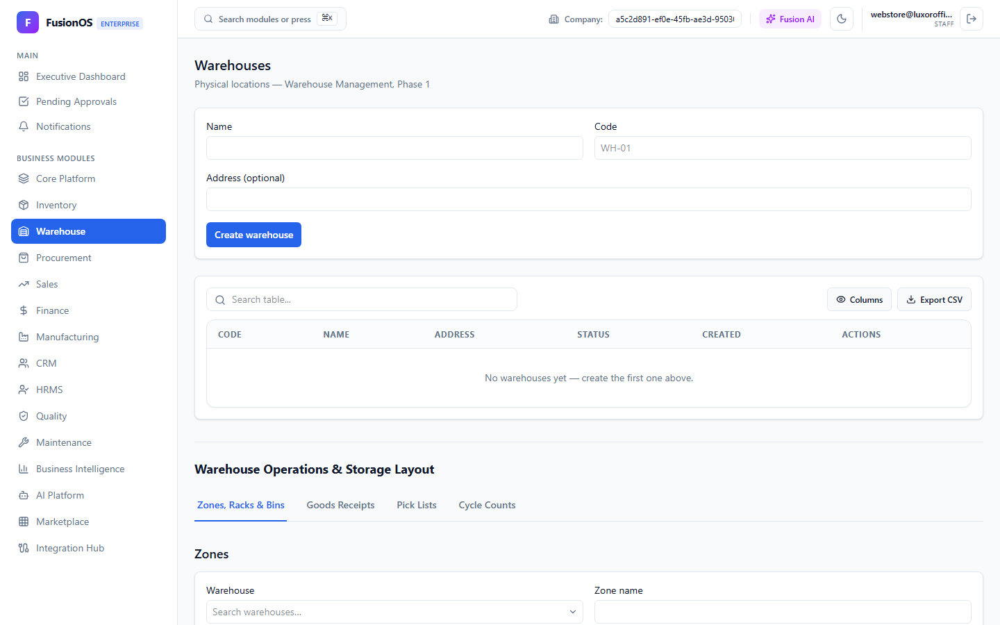
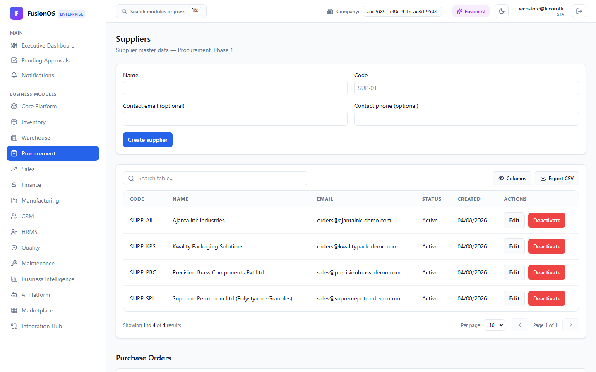
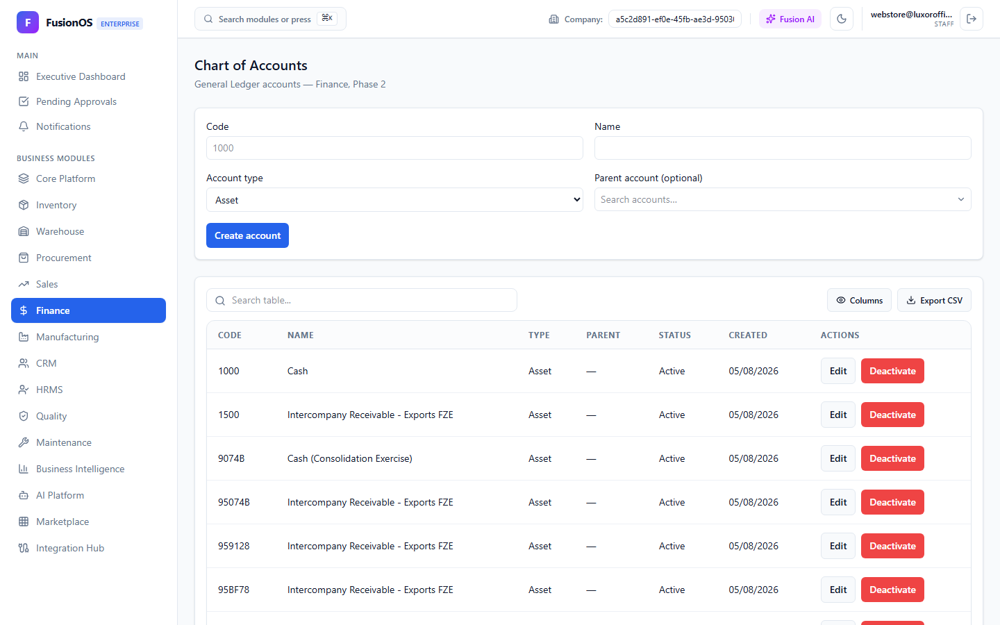

<div align="center">

  

  <br /><br />

  

  <h3>The Open-Source AI-First Enterprise ERP & Operating System</h3>

  <p align="center">
    A production-ready, ultra-scalable enterprise platform built with <b>.NET 8 (Modular Monolith)</b>, <b>React 18</b>, <b>TypeScript</b>, <b>PostgreSQL</b>, <b>Kafka</b>, <b>Redis</b>, and <b>OpenTelemetry</b>.
  </p>

  <p align="center">
    <a href="#key-features">Features</a> •
    <a href="#architecture">Architecture</a> •
    <a href="#module-overview">Modules</a> •
    <a href="#installation-guide">Installation</a> •
    <a href="#tech-stack">Tech Stack</a> •
    <a href="#api-documentation">API Docs</a> •
    <a href="#deployment-guide">Deployment</a>
  </p>

  <p align="center">
    <!-- Version -->
    <a href="https://github.com/worksaransh/FusionOS/releases"></a>
    <!-- License -->
    <a href="LICENSE"></a>
    <!-- Build Status -->
    <a href="https://github.com/worksaransh/FusionOS/actions/workflows/ci.yml"></a>
    <!-- Framework -->
    
    <!-- Frontend -->
    
    <!-- DB -->
    
    <!-- Docker -->
    
    <!-- Platform -->
    
  </p>

</div>

---

## 📋 Table of Contents

- [Executive Summary](#-executive-summary)
  - [What is FusionOS?](#what-is-fusionos)
  - [The Problem FusionOS Solves](#the-problem-fusionos-solves)
  - [Why FusionOS Exists](#why-fusionos-exists)
  - [Core Philosophy](#core-philosophy)
  - [Business Value](#business-value)
- [🖼 Visual Gallery & Screen Tours](#-visual-gallery--screen-tours)
- [🎬 Animated Workflow Demonstrations](#-animated-workflow-demonstrations)
- [🏗 Architecture & Design Principles](#-architecture--design-principles)
- [📦 Enterprise Module Overview (15 Modules)](#-enterprise-module-overview-15-modules)
- [⚙️ Tech Stack Matrix](#%EF%B8%8F-tech-stack-matrix)
- [📂 Directory Structure](#-directory-structure)
- [🚀 Installation Guide](#-installation-guide)
  - [Windows Installation](#1-windows-installation)
  - [macOS Installation](#2-macos-installation)
  - [Ubuntu / Linux Installation](#3-ubuntu--linux-installation)
  - [Docker Compose Installation](#4-docker-compose-installation)
- [🔑 Environment Variables Reference](#-environment-variables-reference)
- [📡 API Documentation](#-api-documentation)
- [🗄 Database & Data Architecture](#-database--data-architecture)
- [🚀 Deployment Guide](#-deployment-guide)
- [🔧 Troubleshooting & FAQ](#-troubleshooting--faq)
- [🤝 Contributing & Community](#-contributing--community)
- [📄 License](#-license)

---

## 💡 Executive Summary

### What is FusionOS?

**FusionOS** is a next-generation, open-source Enterprise Resource Planning (ERP) platform and business operating system designed for mid-market and enterprise organizations. FusionOS unifies every core business function—from **Financial Accounting**, **Supply Chain**, and **Manufacturing (MRP)** to **CRM**, **HRMS**, **Quality Assurance**, and **Predictive AI Operations**—into a cohesive, high-performance web platform.

Engineered as a clean **.NET 8 Modular Monolith** coupled with a modern **React 18 Single Page Application**, FusionOS eliminates the fragmentation, licensing bloat, and operational complexity of legacy systems like SAP, Oracle NetSuite, and Dynamics 365.

### The Problem FusionOS Solves

Traditional enterprise software suffers from severe systemic issues:
1. **Siloed Data & Fragmented Systems**: Accounting, inventory, and sales exist in separate software packages connected by fragile batch scripts.
2. **Exorbitant License & Implementation Fees**: Legacy ERP vendors charge millions in per-user licenses, lock-in support fees, and mandatory upgrade consultants.
3. **Outdated User Interfaces**: Clunky, slow desktop UIs built in the 2000s that hinder employee productivity and require extensive training.
4. **Weak Multi-Tenant Isolation**: Vulnerable SaaS backends that leak sensitive cross-tenant data due to improper database filtering.

### Why FusionOS Exists

FusionOS was built from the ground up to offer an **open, transparent, enterprise-grade alternative**. It provides:
- **Zero License Lock-in**: 100% open-source under the permissive MIT License.
- **Unified Clean Architecture**: Every module strictly obeys CQRS patterns, tenant-isolation pipeline behaviors, and transactional outbox event streams.
- **Sub-Second Performance**: Optimized PostgreSQL queries with `xmin` concurrency controls, Redis distributed caching, and Vite-bundled frontend assets.
- **Embedded AI & Automation**: Native AI Copilot, predictive demand forecasting, automated OCR invoice ingestion, and automated MRP explosion engines.

### Core Philosophy

* **Security & Tenant Isolation by Default**: Every incoming request passes through automated tenant verification behaviors (`TenantIsolationBehavior`) and global JWT authorization policies.
* **Modular Monolith First**: Clean domain separation without the operational chaos of premature microservices. Modules communicate via strongly-typed MediatR commands and Kafka integration events.
* **Developer Experience First**: Instant Docker environment setup, complete TypeScript signatures, OpenAPI / Swagger documentation, and automated CI pipelines.

### Business Value

| Business Area | Legacy ERP Benchmark | FusionOS Advantage | Impact |
| :--- | :--- | :--- | :--- |
| **Total Cost of Ownership (TCO)** | $100k - $1M+ / year | **$0 License Fees** | 90% Cost Reduction |
| **Order Processing Cycle** | 24 - 48 hours | **Real-Time Automated** | 10x Faster Execution |
| **Multi-Tenant Deployment** | Custom database per tenant | **Isolated Unified Engine** | Instant Tenant Onboarding |
| **Manufacturing MRP** | Nightly batch runs | **Sub-Second Explosion Engine** | Immediate Inventory Insight |

---

## 🖼 Visual Gallery & Screen Tours

Here are representative visual captures and interface layouts for key FusionOS operational screens.

### Executive Dashboard
> *Real-time financial analytics, revenue trajectories, inventory throughput, and AI narrative summaries.*


*(Fallback view: Default executive dashboard renders at `/app/dashboard`)*

### Inventory & Stock Ledger
> *Multi-warehouse stock visibility, batch tracking, serial number histories, and bin transfer ledgers.*



### Manufacturing & Bill of Materials (BOM)
> *Multi-level BOM tree explosions, work center capacity planning, machine state tracking, and MRP runs.*



### Warehouse & Logistics
> *3D-mapped warehouse zones, bin/rack/shelf layouts, package consolidation, and goods receipts.*



### Procurement & Supplier Rating
> *RFQ quotes comparison, automated purchase orders, supplier performance ratings, and vendor portals.*



### Financial Ledger & Accounting
> *Double-entry journal entries, chart of accounts, GST tax return summaries, and cash flow statements.*



---

## 🎬 Animated Workflow Demonstrations

Placeholders and workflow walkthroughs for interactive video animations:

| Workflow Demonstration | Visual Preview & Description | Demo Path |
| :--- | :--- | :--- |
| 🔐 **Authentication & Onboarding** | *Zero-friction company creation, admin registration, and JWT token issuance.* | `assets/gifs/auth_flow.gif` |
| 📊 **Real-Time Analytics** | *Live KPI tile stream, interactive chart drilldowns, and OTel metric graphs.* | `assets/gifs/dashboard_analytics.gif` |
| 📦 **Stock Adjustment & Batch Audit** | *Adding stock ledger entries with serial tracking and instant stock updates.* | `assets/gifs/inventory_adjustment.gif` |
| ⚙️ **BOM Explosion & Work Order** | *Multi-level material explosion and automatic work center job scheduling.* | `assets/gifs/manufacturing_mrp.gif` |
| 📑 **GST & Financial Statements** | *Generating automated Balance Sheet, P&L, and GST return tax ledgers.* | `assets/gifs/finance_reports.gif` |
| 🚚 **Goods Receipt & Bin Putaway** | *Receiving purchase order items directly into warehouse storage bins.* | `assets/gifs/warehouse_putaway.gif` |
| 🛒 **RFQ & Purchase Order Approval** | *Vendor quote matrix evaluation and multi-level manager approval.* | `assets/gifs/purchase_orders.gif` |
| 🏷️ **Sales Quotation to Dispatch** | *Converting customer quotes into sales orders, dispatches, and invoices.* | `assets/gifs/sales_dispatch.gif` |

---

## 🏗 Architecture & Design Principles

FusionOS is structured as a **Modular Monolith** using **Clean Architecture** patterns within each domain module.

```
                                  ┌───────────────────────────────────────────┐
                                  │           React 18 SPA (Vite Web)         │
                                  └─────────────────────┬─────────────────────┘
                                                        │ HTTP / REST / WebSockets
                                                        ▼
                                  ┌───────────────────────────────────────────┐
                                  │             FusionOS.Api.Host             │
                                  │   (JWT Auth • Rate Limit • ProblemDetails)│
                                  └─────────────────────┬─────────────────────┘
                                                        │ MediatR Pipeline
               ┌────────────────────────────────────────┼────────────────────────────────────────┐
               ▼                                        ▼                                        ▼
   ┌───────────────────────┐                ┌───────────────────────┐                ┌───────────────────────┐
   │  Core / Auth / Tenant │                │  Finance / Accounting │                │ Manufacturing & MRP   │
   └───────────┬───────────┘                └───────────┬───────────┘                └───────────┬───────────┘
               │                                        │                                        │
               └────────────────────────────────────────┼────────────────────────────────────────┘
                                                        │ EF Core / IDbContext
                                                        ▼
                                  ┌───────────────────────────────────────────┐
                                  │          PostgreSQL 16 Database           │
                                  │   (Multi-Tenant Schema • xmin Concurrency)│
                                  └──────────────┬────────────────────┬───────┘
                                                 │                    │
                                                 ▼                    ▼
                                     ┌───────────────────────┐  ┌───────────┐
                                     │ Redis (Cache & Locks) │  │ Kafka Bus │
                                     └───────────────────────┘  └───────────┘
```

### Key Architectural Highlights
1. **MediatR Pipeline Behaviors**:
   - `LoggingBehavior`: Logs incoming request payloads and execution time.
   - `ValidationBehavior`: Executes FluentValidation rules before domain processing.
   - `AuthorizationBehavior`: Enforces fine-grained permission claims (`Permissions.Inventory.Write`, etc.).
   - `TenantIsolationBehavior`: Reflectively validates that the request's `CompanyId` matches the caller's JWT claim, enforcing strict tenant isolation.
   - `AuditBehavior`: Automatically records domain state mutations in `AuditLogs` with true entity IDs.
2. **PostgreSQL Optimistic Concurrency**: Uses Postgres `xmin` system column (`UseXminAsConcurrencyToken()`) for robust multi-user concurrency control.
3. **Kafka Event Streaming**: Cross-module integration events (e.g., `GoodsReceiptLineReceivedEvent`) are published asynchronously to Kafka topics for eventual consistency across domains.

---

## 📦 Enterprise Module Overview (15 Modules)

FusionOS includes 15 fully-featured enterprise modules:

### 1. 🛡️ Core & Tenant Administration (`FusionOS.Modules.Core`)
- **Multi-Tenant Bootstrap**: Anonymous company initialization with automatic Owner user creation.
- **Role-Based Access Control (RBAC)**: Fine-grained permissions, custom role creation, and user assignment.
- **Audit Logging**: Immutable tracking of all user actions, system modifications, and access logs.

### 2. 💰 Finance & General Ledger (`FusionOS.Modules.Finance`)
- **Chart of Accounts & GL**: Flexible multi-level account trees with automated debit/credit balancing.
- **Journal Entries & Recurring Vouchers**: Template-based recurring transactions and auto-reversals.
- **Financial Statements**: Real-time Balance Sheets, Profit & Loss statements, and Cash Flow reports.
- **Tax & GST Management**: Tax period summaries, GST return calculations, and compliance audit reports.

### 3. 📦 Inventory & Stock Ledger (`FusionOS.Modules.Inventory`)
- **Product Master & SKUs**: Variable product attributes, unit-of-measure conversions, and pricing tiers.
- **Stock Ledger**: Immutable transaction history for all stock movements (receipts, issues, adjustments).
- **Serial & Batch Tracking**: Full lineage tracing for serialized assets and perishable batch lots.

### 4. 🏬 Warehouse Operations (`FusionOS.Modules.Warehouse`)
- **Multi-Warehouse Topology**: Hierarchical layout management down to Warehouse → Zone → Rack → Shelf → Bin.
- **Goods Receipts & Putaway**: Direct integration with Procurement purchase orders for physical stock receiving.
- **Package Picking & Packing**: Consolidation of picking lists and shipment package verification.

### 5. ⚙️ Manufacturing & MRP (`FusionOS.Modules.Manufacturing`)
- **Bill of Materials (BOM)**: Multi-level BOM trees with scrap percentages and routing steps.
- **Work Center & Machine Management**: Work center capacity tracking, hourly cost metrics, and maintenance states.
- **Material Requirements Planning (MRP)**: Sub-second explosion engine calculating net material requirements based on active sales orders.

### 6. 🛒 Procurement & Purchasing (`FusionOS.Modules.Procurement`)
- **Supplier Directory**: Vendor profiles, contact details, payment terms, and performance scorecard ratings.
- **Requests for Quotation (RFQ)**: Multi-vendor quote comparisons and bidding analysis.
- **Purchase Orders (PO)**: Multi-tier approval workflows, PO issuance, and automated receipt matching.

### 7. 🤝 CRM & Sales Pipeline (`FusionOS.Modules.Crm`)
- **Lead & Opportunity Tracking**: Visual Kanban sales pipelines, lead scoring, and stage transitions.
- **Customer Directory**: Comprehensive customer histories, communication logs, and credit limits.
- **Follow-up Tasks & Campaigns**: Automated reminder tasks and marketing campaign tracking.

### 8. 🏷️ Sales & Customer Portal (`FusionOS.Modules.Sales`)
- **Quotations & Sales Orders**: Discount matrix enforcement, quotation conversion, and order locking.
- **Dispatch Management**: Delivery note generation, carrier tracking integration, and partial dispatches.
- **Returns & Credit Notes**: Customer return authorization (RMA) processing linked directly to finance credit notes.

### 9. 👥 HRMS & Payroll (`FusionOS.Modules.Hrms`)
- **Employee Directory**: Complete employee master files, department structures, and designation trees.
- **Leave Management**: Custom leave types, balance tracking, approval workflows, and carry-forward rules.
- **Onboarding & Offboarding**: Task checklists for new hires and employee exit clearing processes.

### 10. 🔬 Quality Control (`FusionOS.Modules.Quality`)
- **Inspection Plans**: Quality criteria specifications for incoming goods, in-process assembly, and final delivery.
- **Quality Audits & Deviations**: Non-conformance reporting (NCR), deviation request approvals, and corrective actions (CAPA).
- **Quality Holds & Certificates**: Quarantining defective stock and issuing Certificates of Analysis (COA).

### 11. 🔧 Maintenance & Asset Operations (`FusionOS.Modules.Maintenance`)
- **Asset Registry**: Equipment master records, depreciation tracking, and location histories.
- **Preventive Maintenance**: Scheduled maintenance templates, meter-reading triggers, and work order generation.
- **Downtime Analytics**: Tracking Mean Time Between Failures (MTBF) and Mean Time to Repair (MTTR).

### 12. 📊 Business Intelligence & Reporting (`FusionOS.Modules.BusinessIntelligence`)
- **Executive Dashboards**: Configurable metric widgets, real-time KPI tiles, and trend visualizations.
- **KPI Engine**: Custom formula builder for calculating enterprise efficiency and operational margins.
- **Export Pipelines**: Scheduled CSV, PDF, and Excel report delivery engine.

### 13. 🤖 AI Platform & Copilot (`FusionOS.Modules.Ai`)
- **Natural Language Search**: Vector-assisted universal search across sales orders, products, and customer records.
- **Demand Forecasting**: Predictive machine learning models predicting stock requirements based on seasonal sales histories.
- **Invoice OCR Processing**: Automated extraction of invoice line items from PDF uploads using OCR.

### 14. 🔌 Integration Hub (`FusionOS.Modules.IntegrationHub`)
- **Webhook Subscriptions**: Event-driven HTTP webhooks for third-party system integration.
- **ETL Data Migration Jobs**: Batch import/export tools supporting legacy SAP, Tally, and QuickBooks data migration.

### 15. 🏪 Plugin Marketplace (`FusionOS.Modules.Marketplace`)
- **Third-Party Extensions**: Modular extension framework allowing custom third-party integrations and custom UI panels to be toggled dynamically.

---

## ⚙️ Tech Stack Matrix

| Layer | Technologies Used | Details & Highlights |
| :--- | :--- | :--- |
| **Backend Framework** | .NET 8 (C#) | Clean Architecture, CQRS, MediatR, FluentValidation |
| **Frontend Framework** | React 18, TypeScript | Single Page Application (SPA), Vite 5, React Router v6 |
| **Styling & UI** | TailwindCSS, Lucide Icons | Responsive modern design, custom dark mode, accessible widgets |
| **Database** | PostgreSQL 16 | Multi-DbContext architecture, Entity Framework Core 8, `xmin` concurrency |
| **Caching & Locking** | Redis 7 | Distributed cache, Distributed locks (`RedLock`) |
| **Event Bus / Messaging**| Apache Kafka | Cross-module integration events, eventual consistency |
| **Authentication** | JWT + BCrypt + Refresh Tokens| SHA-256 hashed refresh tokens, claims-based authorization |
| **Observability** | OpenTelemetry, Prometheus, Grafana | Distributed tracing, application metrics, Loki log aggregation |
| **DevOps & Containers** | Docker, Docker Compose, Nginx | Multi-stage production container builds, reverse proxy |
| **Testing** | Vitest, React Testing Library, Playwright | Unit testing, integration tests, E2E browser automation |

---

## 📂 Directory Structure

```
FusionOS/
├── .github/                      # GitHub Actions CI/CD workflows and issue templates
│   ├── ISSUE_TEMPLATE/           # Bug report and feature request templates
│   ├── workflows/                # CI, CD, and security audit workflows
│   └── PULL_REQUEST_TEMPLATE.md  # PR standards checklist
├── assets/                       # SVG branding, hero banners, screenshots, and visual media
│   ├── banner/                   # High-res hero banner SVG
│   ├── logo/                     # FusionOS brand mark and wordmark SVG
│   └── screenshots/              # High-resolution UI module captures
├── backend/                      # .NET 8 Modular Monolith Solution
│   ├── FusionOS.sln              # Master C# solution manifest
│   ├── src/
│   │   ├── Host/                 # FusionOS.Api (Web API Host application & entrypoint)
│   │   ├── Modules/              # 15 Independent Enterprise Domain Modules
│   │   │   ├── Ai/               # Predictive forecasting & OCR
│   │   │   ├── Core/             # Auth, Users, Roles, Tenant isolation
│   │   │   ├── Finance/          # General Ledger & Tax
│   │   │   ├── Inventory/        # Products & Stock Ledger
│   │   │   ├── Manufacturing/    # BOM & MRP explosion
│   │   │   └── ... (Procurement, Sales, HRMS, Quality, Maintenance, BI, etc.)
│   │   └── Shared/               # BuildingBlocks (MediatR pipeline behaviors, Base Entities)
│   └── tests/                    # xUnit unit and integration test projects
├── docs/                         # Architecture blueprints, database schema, and deployment specs
│   ├── api/                      # OpenAPI specification & endpoint guides
│   ├── architecture/             # SVG diagrams and system flow specs
│   ├── audit/                    # Enterprise completion and sprint audit reports
│   ├── blueprint/                # 14 Master architecture blueprint documents
│   ├── database/                 # ERD and migration guide documentation
│   └── deployment/               # Enterprise production deployment manuals
├── docker/                       # Docker Compose configs & overrides
├── frontend/                     # React 18 + Vite + TypeScript Web Application
│   ├── src/
│   │   ├── app/                  # Application providers and root router
│   │   ├── modules/              # 15 React module panel applications
│   │   ├── public/               # Landing page, solution tours, and public portal
│   │   ├── shared/               # Reusable UI primitives, API client, and Zustand stores
│   │   └── index.css             # TailwindCSS token directives
│   ├── package.json              # Frontend dependency manifest
│   └── vite.config.ts            # Vite build configuration
├── observability/                # Prometheus, Grafana, and OTel Collector configurations
├── scripts/                      # PowerShell & Bash automation scripts (Postgres backup, migrations)
├── docker-compose.yml            # Full-stack local development Docker orchestration
├── README.md                     # Repository Master Documentation
├── LICENSE                       # MIT Open Source License
├── CHANGELOG.md                  # Release version history
├── SECURITY.md                   # Vulnerability reporting guidelines
└── CONTRIBUTING.md               # Developer contribution guidelines
```

---

## 🚀 Installation Guide

### Prerequisite Check
Ensure your environment meets the minimum requirements:
- **Node.js**: v20.0.0 or higher
- **npm** or **pnpm**: npm 10+ / pnpm 9+
- **.NET SDK**: 8.0.x (For backend development)
- **Docker Desktop**: v24.0+ (For containerized services)
- **PostgreSQL**: 16.x (If running without Docker)

---

### 1. Windows Installation

#### Step 1: Install Required Tools
Open PowerShell as Administrator and run:
```powershell
# Install Node.js, Git, and Docker Desktop via winget (or download installers directly)
winget install --id Git.Git -e --source winget
winget install --id OpenJS.NodeJS.LTS -e --source winget
winget install --id Microsoft.DotNet.SDK.8 -e --source winget
winget install --id Docker.DockerDesktop -e --source winget
```

#### Step 2: Clone the Repository
```powershell
git clone https://github.com/worksaransh/FusionOS.git
cd FusionOS
```

#### Step 3: Configure Environment
```powershell
Copy-Item .env.example .env
```

#### Step 4: Launch Frontend Development Server
```powershell
cd frontend
npm install
npm run dev
```
*The web interface will open at `http://localhost:5173`.*

---

### 2. macOS Installation

#### Step 1: Install Tools via Homebrew
```bash
brew update
brew install git node dotnet-sdk docker postgresql@16 redis kafka
```

#### Step 2: Clone & Configure
```bash
git clone https://github.com/worksaransh/FusionOS.git
cd FusionOS
cp .env.example .env
```

#### Step 3: Run Infrastructure Services via Docker Compose
```bash
docker compose up -d postgres redis kafka otel-collector
```

#### Step 4: Launch Web Frontend
```bash
cd frontend
npm install
npm run dev
```

---

### 3. Ubuntu / Linux Installation

```bash
# Update APT and install dependencies
sudo apt update && sudo apt install -y git curl build-essential

# Install Node.js 20
curl -fsSL https://deb.nodesource.com/setup_20.x | sudo -E bash -
sudo apt install -y nodejs

# Install .NET 8 SDK
sudo apt install -y dotnet-sdk-8.0

# Clone Repository
git clone https://github.com/worksaransh/FusionOS.git
cd FusionOS
cp .env.example .env

# Start with Docker Compose
docker compose up --build -d
```

---

### 4. Docker Compose Installation (All Platforms)

The fastest way to spin up the entire production stack (PostgreSQL, Redis, Kafka, OTel Collector, Prometheus, Grafana, API Backend, and React Frontend):

```bash
# Spin up all services in background
docker compose up --build -d

# View live cluster logs
docker compose logs -f

# Stop all services
docker compose down
```

#### Access Endpoints:
- 🌐 **Web Application**: `http://localhost:3000`
- 📡 **REST API Host**: `http://localhost:5000`
- 📑 **Swagger API Docs**: `http://localhost:5000/swagger`
- 📊 **Grafana Dashboard**: `http://localhost:3001` (admin/admin)
- 📈 **Prometheus Metrics**: `http://localhost:9090`

---

## 🔑 Environment Variables Reference

Below is a detailed breakdown of all environment variables configured in `.env.example`:

| Variable | Required | Default Value | Description / Security Notes |
| :--- | :---: | :--- | :--- |
| `ASPNETCORE_ENVIRONMENT` | Yes | `Development` | ASP.NET Core environment mode (`Development`, `Staging`, `Production`). |
| `PORT` | Yes | `5000` | Port for the backend API host. |
| `ConnectionStrings__Postgres`| Yes | `Host=localhost;...` | PostgreSQL connection string. Must be set securely in production. |
| `Jwt__SigningKey` | **YES** | *(Dev Secret)* | Secret key for signing JWTs. **MUST BE AT LEAST 256 BITS IN PROD**. |
| `Jwt__Issuer` | Yes | `FusionOS.Host` | JWT token issuer header value. |
| `Jwt__Audience` | Yes | `FusionOS.App` | JWT token target audience header value. |
| `Jwt__AccessTokenExpirationMinutes` | No | `15` | Expiration time for access tokens in minutes. |
| `REDIS_HOST` | Yes | `localhost` | Hostname for Redis cache instance. |
| `KAFKA_BOOTSTRAP_SERVERS` | Yes | `localhost:9092` | Kafka broker bootstrap addresses. |
| `VITE_API_BASE_URL` | Yes | `http://localhost:5000/api/v1` | Base URL used by React frontend to call the API. |

---

## 📡 API Documentation

FusionOS provides a unified RESTful API conforming to RFC 7807 `ProblemDetails` error formats.

### Authentication Headers
All protected API endpoints require a valid Bearer token in the HTTP Authorization header:
```http
Authorization: Bearer <your_jwt_access_token>
```

### Core API Endpoints Reference

| Module | Method | Endpoint | Description | Auth Required |
| :--- | :---: | :--- | :--- | :---: |
| **Auth** | `POST` | `/api/v1/core/auth/login` | User login & JWT issuance | ❌ No |
| **Auth** | `POST` | `/api/v1/core/auth/refresh` | Refresh access token using opaque refresh token | ❌ No |
| **Company** | `POST` | `/api/v1/core/companies` | Bootstrap a new tenant company anonymously | ❌ No |
| **Inventory**| `GET` | `/api/v1/inventory/products` | Query paginated product master catalog | ✅ Yes |
| **Inventory**| `POST` | `/api/v1/inventory/products` | Create a new SKU product | ✅ Yes |
| **Manufacturing**| `POST` | `/api/v1/manufacturing/mrp/explode` | Run sub-second MRP explosion for sales order | ✅ Yes |
| **Finance** | `GET` | `/api/v1/finance/accounts` | Fetch Chart of Accounts tree | ✅ Yes |
| **Procurement**| `GET` | `/api/v1/procurement/purchase-orders` | List purchase orders with status filtering | ✅ Yes |

### Example API Request (Login)
```bash
curl -X POST http://localhost:5000/api/v1/core/auth/login \
  -H "Content-Type: application/json" \
  -d '{
    "email": "admin@fusionos.org",
    "password": "SecurePassword123!"
  }'
```

### Example API Response
```json
{
  "accessToken": "eyJhbGciOiJIUzI1NiIsInR5cCI6IkpXVCJ9...",
  "refreshToken": "7f8b9c1d2e3f4a5b6c7d8e9f...",
  "expiresIn": 900,
  "user": {
    "id": "c3a1b2c4-d5e6-7f8a-9b0c-1d2e3f4a5b6c",
    "email": "admin@fusionos.org",
    "fullName": "Enterprise Administrator",
    "companyId": "a1b2c3d4-e5f6-7a8b-9c0d-1e2f3a4b5c6d"
  }
}
```

---

## 🗄 Database & Data Architecture

FusionOS uses **PostgreSQL 16** with a DbContext-per-module layout ensuring clean database separation.

```
                          ┌─────────────────────────────────────────┐
                          │         PostgreSQL Database             │
                          └────────────────────┬────────────────────┘
                                               │
     ┌──────────────────┬──────────────────────┼──────────────────────┬──────────────────┐
     ▼                  ▼                      ▼                      ▼                  ▼
┌──────────────┐ ┌──────────────┐     ┌──────────────────┐  ┌──────────────────┐ ┌──────────────┐
│ CoreDbContext│ │FinanceDbCtx  │     │InventoryDbContext│  │ManufactureDbCtx  │ │ SalesDbContext│
└──────────────┘ └──────────────┘     └──────────────────┘  └──────────────────┘ └──────────────┘
```

### Database Backup & Restore Automation

Automation scripts are included in `scripts/`:

```bash
# Take a complete database backup
./scripts/backup-postgres.sh

# Restore a database snapshot
./scripts/restore-postgres.sh backups/fusionos_backup_2026-07-27.sql.gz
```

---

## 🚀 Deployment Guide

### Production Nginx Reverse Proxy Configuration
Place the following in `/etc/nginx/sites-available/fusionos`:

```nginx
server {
    listen 80;
    server_name erp.yourdomain.com;

    location / {
        root /var/www/fusionos/frontend/dist;
        try_files $uri $uri/ /index.html;
    }

    location /api/ {
        proxy_pass http://localhost:5000;
        proxy_http_version 1.1;
        proxy_set_header Upgrade $http_upgrade;
        proxy_set_header Connection 'keep-alive';
        proxy_set_header Host $host;
        proxy_cache_bypass $http_upgrade;
        proxy_set_header X-Forwarded-For $proxy_add_x_forwarded_for;
        proxy_set_header X-Forwarded-Proto $scheme;
    }
}
```

---

## 🔧 Troubleshooting & FAQ

### FAQ & Common Solutions

#### Q1: `dotnet build` fails with "No .NET SDKs were found"?
> **Solution**: Ensure .NET 8 SDK is installed and added to your system PATH. Verify by running `dotnet --info`.

#### Q2: Frontend shows 401 Unauthorized errors on API calls?
> **Solution**: Check that your `Jwt__SigningKey` in `.env` matches the backend setting and is at least 32 characters long.

#### Q3: Database connection fails on `docker compose up`?
> **Solution**: Ensure PostgreSQL container health check passes before backend starts. Verify container status with `docker compose ps`.

---

## 🤝 Contributing & Community

We welcome open-source contributions! Please review our guidelines:
- 📖 [Contributing Guidelines](CONTRIBUTING.md)
- 📜 [Code of Conduct](CODE_OF_CONDUCT.md)
- 🔒 [Security Policy](SECURITY.md)
- 📜 [Changelog](CHANGELOG.md)

---

## 📄 License

FusionOS is open-source software licensed under the **[MIT License](LICENSE)**.

<div align="center">
  <sub>Built with ❤️ by Saransh Gulati and the global FusionOS Open Source Community.</sub>
</div>
